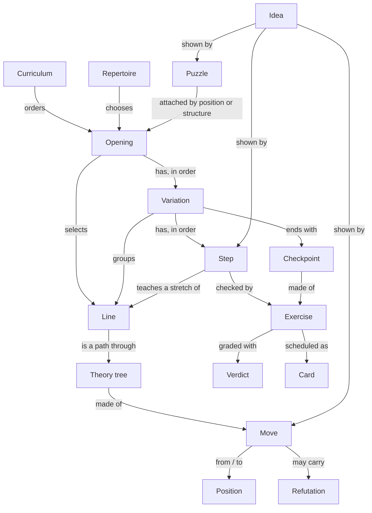

# The model: what the site is made of

The things a learner meets: first the hierarchy, from the largest to the smallest, then what sits beside it, then how
they connect. Each says where it lives in v1.

## The hierarchy

**Repertoire.** The openings a learner has chosen, together: one for White, one against 1.e4, one against 1.d4 (and
later the rest). Measured by **coverage**: the share of games at their level that stay inside what they know, move by
move. _v1: "courses I am learning" (enrolled openings in `data/training-settings.ts`); `make gaps` (`scripts/gaps.ts`)
measures holes for the whole catalogue._ **Rename: v1's "courses I am learning" becomes the repertoire.**

**Opening.** One opening for one side, such as "Italian Game, as White": an introduction (idea, risks, who it suits,
origin), its variations in order, its ideas, its puzzles, a final test. _v1: a course,
`content/courses/<id>/course.yaml`; `projectCourse` and `buildOpening` build its tree._ **Rename: a v1 course becomes
an opening.** In v1 "opening" also named the family level in `content/openings.yaml` (which says who plays a course:
"playing it" or "playing against it"). That file is parked in v2 (inventory.md), so the word is free for this meaning.

**Variation.** A named branch of an opening, using Lichess's names: the Giuoco Piano, the Two Knights Defence. Within
an opening it is a group of steps round one decision ("When Black plays 3...Nf6"), and it ends with a **checkpoint**:
a mixed test of its steps. _v1: a course line's `section`, shown as groups on the course page and in Create; Lichess
opening names come from `content/lichess.ts`._ **Rename: a v1 `section` becomes a variation.**

**Line.** One exact sequence of moves, written for one side, from where it branches off another line: a main line, a
sideline, a rare line, a gambit, a trap. All lines together are the **theory tree**. _v1: the PGN files in
`content/tree/`, which v1 calls chapters; `resolveTree` in `content/theory-tree.ts`._ **Rename: v1's PGN "chapter"
files become lines everywhere.**

**Step.** About four of the learner's moves: the chunk learned and tested at once, five to ten minutes. A step has a
title, two to four sentences of text, the stretch of a line it teaches, the ideas it shows, and a check. It runs
through five **stages**: Read, Watch, Try, Their mistakes, Done (experience.md). _v1: units (`training/units/`,
`courseUnits`), cut automatically, with `units:` overrides in course.yaml._ v2 keeps the automatic cut as the default
and lets an author name a step and write its text. **Rename: a v1 unit becomes a step.**

## Beside the hierarchy

**Idea.** A reusable piece of understanding that has a name: a tactic (fork, pin), a plan (minority attack, kingside
pawn storm), a structure (Carlsbad, isolated queen's pawn), a principle (develop before attacking), a trap pattern
(the Fried Liver). An idea has a page with a short explanation and every step, move and puzzle that shows it. _v1:
motifs in `content/motifs.yaml` and the Glossary page (`features/glossary`); course `plans` as plain sentences;
`explain/motif.ts` spots some motifs on the board._ v2 widens motifs into ideas of several kinds.

**Position.** A board state, keyed by EPD so transpositions are one position. _v1: everywhere; `chess/epd.ts`,
`positionId`._

**Move.** A move out of a position, with its annotation: comment, marks (`[%cal]` / `[%csl]`), symbol (`?`, `!`, as PGN
NAGs) and tags. One comment per move across the whole site. _v1: `LineEdge` and `Annotation` in `schema/built.ts`;
marks in `content/marks.ts`._

**Refutation.** A wrong move with the reason it is wrong: a PGN variation starting with a move marked `?` or `??`.
Shown when someone plays that move; never a line, never drilled. _New; the PGN reader already keeps variations and
NAGs (`chess/pgn.ts`)._ (A PGN variation is the file format's word for moves in brackets, not a variation of an
opening.)

**Exercise.** Anything the learner answers: play a move, replay a stretch, answer a question in words, solve a puzzle,
play on from a position. Every exercise is graded and recorded the same way. _v1: review cards (`training/cards.ts`),
quizzes, Speed lines, Name it positions, each with its own store._

**Puzzle.** A tactic from a real game, from the Lichess puzzle database, attached to the openings whose positions or
pawn structures it comes from. _New._

**Verdict.** How good a move is in a position and why: a grade, a symbol, the cost, the punishing reply, the author's
note. _New; grows from `training/regret.ts` and `data/analysis.ts`._

**Curriculum.** The order openings are best taken in, as tracks: "a first repertoire with 1.e4", "a first repertoire
with 1.d4", "traps every beginner should know". _v1: `content/curriculum.yaml` with prerequisites._

## How they relate

Two rules keep this simple:

- **Lines are shared, steps are not.** The theory tree belongs to the site; a line can be in many openings. A step
  belongs to one opening, because the same moves are taught differently in different openings. _v1 already separates
  the tree from courses this way._
- **Material keyed by position attaches itself.** A puzzle, a refutation, an explorer count or an evaluation is stored
  against a position, and appears in every opening that reaches it. Nothing is copied into an opening by hand.

## Progress, per piece

| Piece      | States                                                                        | v1                                           |
| ---------- | ----------------------------------------------------------------------------- | -------------------------------------------- |
| Repertoire | coverage by move 5, 10, 15 at the learner's band                              | new                                          |
| Opening    | percent of moves known and mastered; final test passed                        | partly, on Overview                          |
| Variation  | locked, open, checkpoint passed                                               | new                                          |
| Step       | locked, open, learning, passed, mastered (from its moves)                     | unit states (`features/path/unit-state.ts`)  |
| Move       | new, learning, known (last two answers good), mastered (FSRS 7 days and more) | cards, `unitProgress` in `units/progress.ts` |
| Idea       | seen, practised (puzzles and moves showing it answered well)                  | new                                          |

A line has no progress of its own: it is shared, so what a learner knows of it is the progress of its moves.

State stays derived from the answer log, never stored, as v1 does for units.

## What stays fixed

Learner history is keyed by v1 course id and position (`card id = <course>:<epd>`) and line ids appear in it.
Renaming a course or line id loses history, so v2 keeps every existing id: an opening's id is its v1 course id, and a
line's id is its v1 PGN file name. The renames (course to opening, `section` to variation, unit to step, PGN "chapter"
to line) are in words and new code, not in ids or files.
